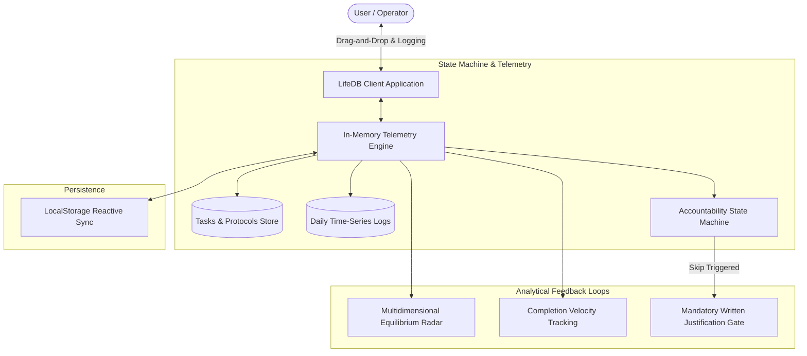

# Life Tracker (LifeDB)

> Personal operating system and activity telemetry engine featuring 24-hour timeline scheduling, multidimensional equilibrium analytics, and offline-first persistence.

[](https://life-db-roan.vercel.app)
[](https://react.dev/)
[](https://www.typescriptlang.org/)
[](https://vitejs.dev/)
[](https://opensource.org/licenses/MIT)

**Live Production URL:** [https://life-db-roan.vercel.app](https://life-db-roan.vercel.app)

---

## Overview

Life Tracker (LifeDB) is a personal productivity and time telemetry platform built for developers and operators managing structured daily routines. Built with **React 19, TypeScript, and Vite**, it integrates time-series calendar scheduling with strict behavioral state machines and real-time radar analytics.

---

## System Architecture



---

## Key Features

### 1. Interactive 24-Hour Timeline Scheduler
* Sub-hour precision scheduling with Day, Week, and Month planning views.
* Interactive drag-and-drop rescheduling with visual collision detection for overlapping deep work blocks.

### 2. High-Friction Accountability Gate
* Bypassing high-priority protocols requires entering a mandatory written explanation (minimum 20 characters) to discourage impulsive procrastination.
* Automatically updates streaks and commits excuses to immutable daily audit records.

### 3. Multidimensional Balance Radar
* Real-time radar visualization calculating life domain equilibrium across Social, Spiritual, Study, Gym, Diet, Work, and Balance.
* Identifies under-indexed domains algorithmically to guide schedule adjustments.

### 4. Offline-First In-Memory Architecture
* Reactive state updates execute with sub-millisecond responsiveness with zero server lag.
* Transparent persistence layer synchronizes structured JSON records to browser local storage.

---

## Tech Stack

* **Framework:** React 19, TypeScript, Vite
* **Styling:** Modular CSS3 (Custom Glassmorphism Design System, Responsive Breakpoints)
* **Icons:** Lucide React
* **Hosting:** Vercel Global Edge Network

---

## Local Development

```bash
# Clone the repository
git clone https://github.com/harkiratsinghh27-sketch/life-tracker.git
cd life-tracker

# Install dependencies
npm install

# Run the local development server
npm run dev
```

---

## License

MIT License. See [LICENSE](LICENSE) for details.
